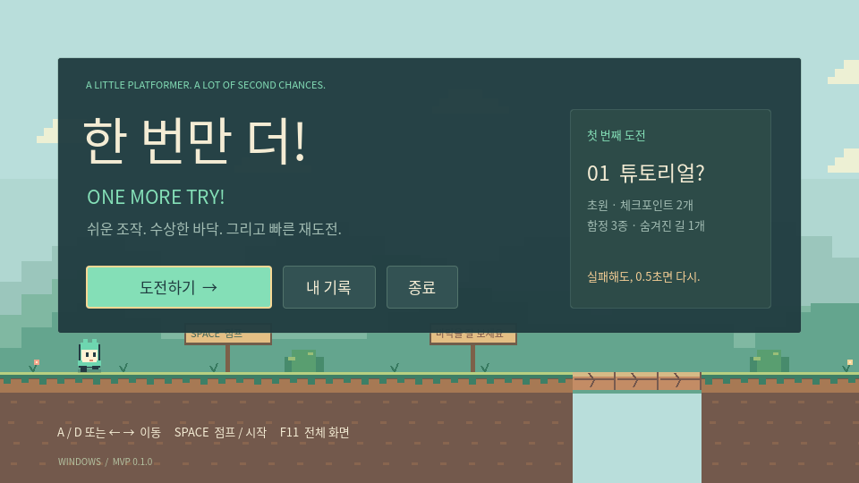
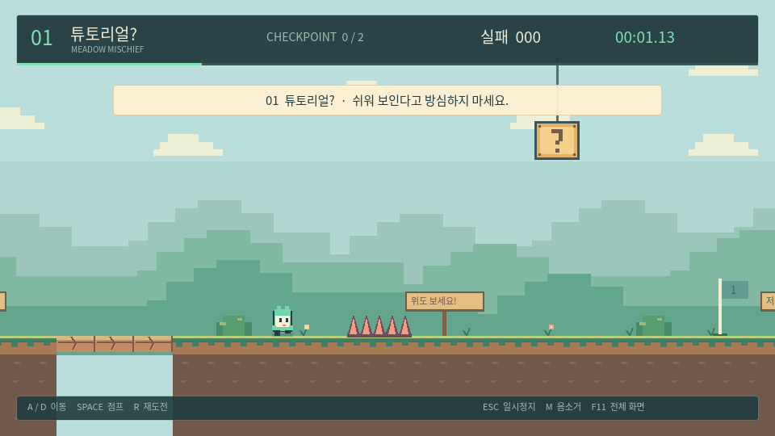

# 한 번만 더! · ONE MORE TRY!

쉬운 조작, 수상한 바닥, 빠른 재도전. Godot 4.6.3으로 만든 Windows용 2D 트랩 플랫포머입니다.

**[Windows 다운로드](https://github.com/nu4ddi4/side-scroller-game/releases/latest)** · [기획안](docs/DESIGN.md) · [개발 및 브랜치 운영](docs/DEVELOPMENT.md) · [검증 결과](docs/VALIDATION.md)



## 플레이

릴리스의 **`OneMoreTry-v0.2.0-Windows-x64-Setup.exe`**를 실행하면 사용자 계정에 설치됩니다. 시작 메뉴에서 **One More Try!**를 실행하세요. 관리자 권한은 필요하지 않으며 바탕 화면 바로 가기는 설치 중 선택할 수 있습니다. 설치 없이 실행하려면 함께 제공하는 ZIP을 풀고 `OneMoreTry.exe`를 실행하세요. Godot이나 별도 런타임을 설치할 필요가 없습니다. Windows 10/11 64비트와 OpenGL 3.3 호환 그래픽 환경을 대상으로 합니다.

| 키 | 동작 |
| --- | --- |
| A / D, ← / → | 이동 |
| Space | 점프 · 길게 누르면 더 높이 |
| R | 마지막 체크포인트에서 즉시 재도전 |
| ESC | 일시정지 · 계속하기 |
| M | 음소거 전환 |
| F11 | 전체 화면 전환 |
| Tab / Enter | 메뉴 이동 · 선택 |

R 재도전은 실패 1회로 집계합니다. 일시정지 메뉴의 `처음부터 재도전`은 새 도전을 시작합니다. 클리어 시간은 실패·복귀 시간을 포함하며 일시정지 시간은 제외합니다. 진행 위치는 현재 도전 중에 유지하고, 개인 기록은 프로그램 종료 후에도 저장합니다.

## 업데이트

Windows 배포본은 시작할 때 GitHub의 최신 정식 릴리스를 한 번 확인합니다. 타이틀의 **업데이트 확인 / 새 버전 받기 → 다운로드 → 설치하고 종료**에서 직접 설치할 수 있습니다. 다운로드한 설치 파일의 크기와 GitHub의 SHA-256이 일치해야 실행합니다. 다운로드 취소·연결 실패 후에도 게임은 계속할 수 있고, 인터넷 없이 플레이할 수 있습니다. 미리보기 릴리스와 이전 버전은 설치하지 않습니다.

설치는 기존 사용자 설치를 갱신하며 기록은 유지합니다. Windows 설정에서 게임을 제거해도 기록은 남습니다. 기존 v0.1.0에는 업데이트 기능이 없으므로 v0.2.0 설치 파일을 한 번 직접 실행해야 합니다. ZIP 사용자도 업데이트를 설치하면 설치형으로 전환됩니다.

## 현재 버전: 초원 MVP

기획안의 최소 기능 제품 범위인 **스테이지 1개**를 먼저 완성했습니다.

- 가변 점프, 공중 제어, 코요테 타임과 점프 입력 버퍼
- 밟으면 무너지는 발판, 접근 시 돌출되는 가시, 경고 후 떨어지는 블록
- 약 0.38초 뒤 자동 복귀, 체크포인트 2개, 카메라 추적
- 한국어 메뉴·HUD·일시정지·클리어 화면과 사망 횟수 메시지
- 총 실패, 도전·클리어 수, 최고 시간, 노데스와 비밀 발견 기록
- 숨겨진 별과 상단 경로, 자체 합성한 칩튠 BGM과 효과음



스테이지 2~5, 움직이는 장애물, 가짜 코인 등 추가 기믹은 후속 개발 범위입니다. 현재 기록은 첫 스테이지를 기준으로 집계합니다. 기존 `index.html`은 과거 웹 초안이며 현재 게임의 실행 파일은 위 Windows 릴리스입니다.

## 개발

Godot 4.6.3 Standard에서 `project.godot`을 열고 F5로 실행합니다.

```bash
godot --headless --editor --import --quit
godot --headless --fixed-fps 120 --script tests/run_tests.gd -- --test
godot --headless --fixed-fps 120 --script tests/playthrough.gd -- --test
python3 tools/test_updater.py
```

개발 흐름은 **`beta`에서 기능 브랜치 생성 → `beta` PR 병합 → `main` 배포 PR 병합**입니다. GitHub Actions에서 브랜치 방향, 물리·저장 회귀 검사, 전체 스테이지 통과, Windows 빌드·설치·재설치·제거와 기록 보존을 확인합니다. `main` 병합 후 새 프로젝트 버전이면 검증한 설치 파일과 ZIP을 정식 GitHub 릴리스로 게시합니다.

코드와 원본 오디오 생성 도구는 이 저장소에 있습니다. Noto Sans CJK 폰트와 Godot 및 엔진 내 제3자 구성 요소의 라이선스는 `assets/fonts/LICENSE.txt`, `docs/GODOT_LICENSE.txt`, `docs/GODOT_COPYRIGHT.txt`를 참고하세요.
